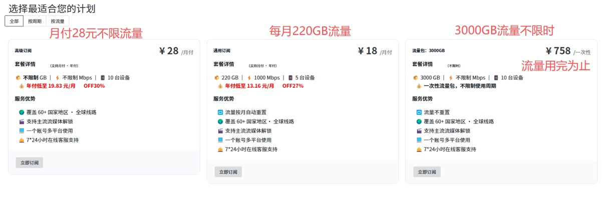

# 机场推荐 2026：稳定高速翻墙机场 / VPN 推荐（每月更新）

> **内容最后更新：2026年10月30日**｜本页每月更新，榜单内均为国内实测可用的翻墙机场节点，采用 Shadowsocks / V2Ray / Trojan 等协议，稳定高速。

## 快速结论：2026 年机场推荐怎么选？

- **要性价比，追剧 + AI 全都要**：选 [超实惠机场](#超实惠机场)，年付低至 5.25 元/月，还送 Emby 全网影视会员。
- **要稳定，做外贸或长期备用**：选 [狗狗加速VPN](#狗狗加速vpn)，注册送 3 天免费，高速专线。
- **要便宜，流量不限时慢慢用**：选 [飞鸟云机场](#飞鸟云机场)，10 元/月起，不限时套餐流量用完才停。
- **要速度，专线直连**：选 [蜂群cheap](#蜂群cheap)，直连原生双线路，千兆下行。
- **要专线，流量不限时慢慢用**：选 [扬帆云机场](#扬帆云机场)，19.99 元/月起，IEPL 专线+不限时流量包，流量用完才停。

**目录**：[机场推荐榜](#机场推荐榜2026年10月) · [超实惠机场](#超实惠机场) · [狗狗加速VPN](#狗狗加速vpn) · [飞鸟云机场](#飞鸟云机场) · [蜂群cheap](#蜂群cheap) · [扬帆云机场](#扬帆云机场) · [机场选购指南](#机场选购指南) · [常见问题](#常见问题-faq) · [客户端下载](#客户端下载)

## 机场推荐榜（2026年10月）

| 排名 | 机场 | 线路与协议 | 解锁能力 | 适合人群 | 官网直达 |
|:--:|---|---|---|---|---|
| 🥇 | 超实惠机场 | 高质量线路，晚高峰 8K 秒开 | Netflix / Disney+ / TikTok / ChatGPT / DeepSeek | 追剧、AI 工具、主力机场 | [立即前往](https://cutt.ly/8tI4oH54) |
| 🥈 | 狗狗加速VPN | 高速专线，Hysteria2 协议 | 流媒体、ChatGPT | 外贸、长期备用 | [立即前往](https://www.dginv.click/#/register?code=sCbWVzQl) |
| 🥉 | 飞鸟云机场 | 节点多、线路多，三年老牌 | ChatGPT / Netflix / TikTok / Telegram | 备用机场、高性价比 | [立即前往](https://cutt.ly/Ct9Sj2me) |
| 4 | 蜂群cheap | 专线直连，原生双线路 | ChatGPT / Netflix / YouTube 4K / TikTok | 要速度的用户 | [立即前往](https://fengqun.io/#/register?code=MKPsTRgw) |
| 5 | 扬帆云机场 | IEPL 专线，不限时流量包 | Netflix / Disney+ / ChatGPT / TikTok | 主力机场、游戏、流媒体 | [立即前往](https://ml.yfqz1.net/register?code=5Vo0aBUf) |

> 排序依据线路质量、晚高峰稳定性、解锁能力与性价比综合评估。建议主力 + 备用搭配 2 家以上，单家故障时可无缝切换。

## 超实惠机场

**2026 高性价比机场推荐：高速稳定的翻墙 VPN，送全网影视会员**

### 📌 官网直达：https://cutt.ly/8tI4oH54

为什么选择超实惠机场？

✅ 新增福利！ 购买 超实惠机场 送 Emby全网影视会员，免费看超多优质影片！

✅ 高速稳定——高质量线路，晚高峰照样秒开8K视频，YouTube测速高达40W+

✅ 安全防封号，IP节点质量高，伪装度高！无惧TG, 推特, Facebook等账号被封

✅ 全平台支持——Windows、Mac、iOS、Android、Linux，无限制设备数

✅ 流媒体解锁——畅享Netflix、Disney+、HBO、TikTok、ChatGPT、Deepseek等海外应用

✅ 高性价比——年付低至 5.25 元/月，不限时套餐流量用完才停，真正超值！

✅ 不限速、不限设备数，完美适配海外应用

超实惠机场最新套餐（2026） 新价格🚀

#### 💸月付套餐（不限设备）：
月付A｜15元/月 流量：每月400G 设备：不限设备数量

月付B｜21元/月 流量：每月600G 设备：不限设备数量

月付C｜27元/月 流量：每月900G 设备：不限设备数量

👉 适合高频使用、追剧、AI 工具、日常翻墙用户

#### 📅 年付套餐（性价比优先）：
年付A｜63元/年（≈5.25元/月）流量：每月160G（全年1920G）设备：不限设备数量

年付B｜207元/年（≈17.25元/月）流量：每月600G（全年7200G）设备：不限设备数量

👉 长期使用直接上年付，稳定、省心、不折腾

#### 🌟 不限时套餐（一次购买，长期可用）【🎉80%小伙伴选择此类套餐】

51元：流量666G | 不限设备数量   灵活选择，约可用3-5个月

90元：流量1200G | 不限设备数量  灵活选择，约13-14个月，买得多省得多！

#### 为什么选择不限时套餐？

无限流量，畅享不间断：避免流量限制，适合长时间使用。

不受月度限制：不再担心流量用完，适合重度使用者。

多设备同时在线：可在更多设备上同时使用，无需担心设备限制。

🚀 不限时套餐说明：流量用完才停！不按时间计费，用1年、2年都没问题！

#### 买机场送emby影视会员服务

测速图

## 狗狗加速VPN

**稳定高速 VPN 推荐：注册送 3 天免费，外贸与长期备用的机场之选**

### 🆗 [官网传送门](https://www.dginv.click/#/register?code=sCbWVzQl)
注册送三天免费使用,稳定输出服务。适合做外贸。稳定性高，可长期备用。稀缺资源。

#### 1. 标准套餐 ¥15.80/月
   - 流量160G
   - 半年付9.5折，年付9折
   - 解锁流媒体及ChatGPT

#### 2. 高级套餐 ¥20.80/月
   - 流量200G
   - 半年付9折，年付8折
   - 高速专线，解锁流媒体及ChatGPT

#### 3. 豪华套餐 ¥39.80/月
   - 流量500G
   - 年付7.5折，2年付6折
   - 高速专线，极低延迟，全球独家Hysteria2协议

## 飞鸟云机场

**便宜好用的备用机场推荐：不限时套餐，流量用完才停**

### 官网地址：https://cutt.ly/Ct9Sj2me
|  飞鸟云机场 | 付款周期 | 价格 | 每月流量 | 同时在线数量 |
|  ----  | ----  | ----  | ----  |----  |
| 10元月付  | 月付 | 10元  | 200G | 不限设备数量  |
| 15元月付  | 月付 | 15元  | 400G | 不限设备数量  |
| 20元月付  | 月付 | 20元  | 600G | 不限设备数量  |
| 不限时套餐  | 10000G流量不限时| 300元 | 10000G | 不限设备数量 |
| 不限时套餐  | 5000G流量不限时| 150元 | 5000G | 不限设备数量 |
| 不限时套餐  | 2400G流量不限时| 80元 | 2400G | 不限设备数量 |
| 【推荐,最划算】不限时套餐  | 1200G流量不限时| 40元 | 1200G | 不限设备数量 |
| 【推荐，最划算】不限时套餐  | 600G流量不限时| 20元 | 600G | 不限设备数量 |
| 不限时套餐  | 400G流量不限时| 15元 | 400G | 不限设备数量 |
| 不限时套餐  | 200G流量不限时| 10元 | 200G | 不限设备数量 |

不限使用时间，不限设备数量，三年老牌机场，线路&节点多、稳定

同时解锁ChatGPT和Netflix TikTok Telegram ！价格非常诱人！非常适合做备用机场！

## 蜂群cheap

**专线直连机场推荐：原生双线路，千兆下行速率**

### 📌 官网直达：[https://cutt.ly/dtXjjjyR](https://fengqun.io/#/register?code=MKPsTRgw)

蜂群cheap，专线，直连原生双线路，安全稳定，支持 Windows、安卓、iOS、Mac、电视路由器等设备使用。开源工具不记录任何用户信息数据，覆盖 60+ 国家地区·全球线路，专线千兆下行速率，解锁 GPT、奈飞、YouTube 4K、TikTok、DMM 等所有流媒体。

长期在线节点大约 50 余个，带宽 1000MB。

#### 套餐价格

- 通用订阅：18 元/月，220G 流量，1000Mbps，5 台设备（年付低至 13.16 元/月）
- 高级订阅：28 元/月，不限流量、不限速，10 台设备（年付低至 19.83 元/月）
- 不限时流量包：3000G 一次性 758 元，流量用完为止，不限使用周期

## 扬帆云机场

**IEPL 专线机场推荐：月付 19.99 元起，不限时流量包用完才停**

### 📌 官网直达：[https://cutt.ly/GyT87sai](https://ml.yfqz1.net/register?code=5Vo0aBUf)

月付 ¥19.99/100GB 起，200Mbps，2 台设备，入门门槛不高。LV2 月付 ¥29.99/200GB，300Mbps，3 台设备，日常主力用这个档最划算！

最大亮点是不限时流量包：¥119/100GB 起，一次购买用完为止，没有任何时间限制！用得少、不想每个月续费的朋友直接冲这个，用一年两年都没问题！

LV3（¥39.99/月）以上带 IEPL 专线，LV4（¥49.99/月）更是全 IEPL 专线，2Gbps 带宽，6 台设备，游戏、4K 流媒体、跨国办公都 hold 得住！

全球节点，Netflix、Disney+、ChatGPT、TikTok 全解锁！

## 机场选购指南

**买机场之前先想清楚这几件事，少交学费**

1. **先定用途，再看价格**：

   - **追剧党**：重点看流媒体解锁和晚高峰速度，白天测速再快也没用，晚上 8–10 点不卡才算数。
   - **AI 和办公**：重点看稳定性，ChatGPT、DeepSeek 这些断一次就得重来，线路稳比峰值速度重要。
   - **偶尔用**：一个月用不了几次的，别买月付套餐，不限时流量包更划算，用完才停。
   - **游戏玩家**：重点看延迟和落地地区，节点离游戏服务器越近越好，先买月付实测。

2. **判断一家机场靠不靠谱，看这三点**：

   - **活了多久**：开业时间越长，跑路成本越高。新机场不是不能买，但只建议月付试水。
   - **有没有正经门面**：固定官网、公告渠道、客服入口齐全的，出问题至少找得到人；只靠一个 TG 群卖卡的，谨慎。
   - **线路说不说得清**：敢写明是专线还是中转、节点在哪些地区的，通常心里有底；只喊"高速稳定"四个字的，多问两句再掏钱。

3. **正确的买法**：

   - **先月付，后长期**：任何一家第一次买都先上月付，用一周覆盖工作日和周末晚高峰，再决定要不要年付。
   - **主力 + 备用**：手里至少留两家不同线路的，一家出问题立刻切另一家，不耽误事。
   - **别囤多年套餐**：再稳的机场也扛不住政策变化，一次买两三年等于把风险全揽在自己身上。

4. **太便宜和免费的，为什么不建议当主力**：

   - 免费节点来源不明，速度没保障还是小事，流量经过谁的服务器你根本不知道，账号密码别往里输。
   - 便宜得离谱的套餐，成本只能从超售和缩减线路里找，晚高峰挤成什么样可想而知；靠低价冲一波量再跑路的，每年都有。

5. **几个特殊情况先说清**：

   - **地区差异**：福建、江苏、浙江和部分校园网对直连线路不友好，这些地方优先选中转或专线机场。
   - **敏感时期**：重大会议、节日前后线路波动是常态，这不是哪一家的毛病，备好第二家就不用干等。
   - **公司网络**：单位网络可能屏蔽常见端口，买之前先问客服有没有解决方案，别买完才发现连不上。

### 注意：2026 年，很多国外大牌 VPN 在中国大陆已经用不了了。本页推荐的都是走 Shadowsocks、V2Ray、Trojan 等协议的机场节点，国内实测能连、速度经得起晚高峰，才会留在榜单上。

## 常见问题 FAQ

### 机场和 VPN 有什么区别？
广义上都是翻墙工具。"机场"是中文圈对订阅制代理服务的俗称，基于 Shadowsocks / V2Ray / Trojan 等协议，通过订阅链接在客户端（如 Clash、Shadowrocket）中使用；传统 VPN 则是整机隧道。本页推荐的机场节点均为国内实测可用，速度与稳定性普遍优于普通 VPN。

### 2026 年机场推荐首选哪家？
看需求：追求性价比和影视解锁选 [超实惠机场](#超实惠机场)（年付低至 5.25 元/月，送 Emby 会员）；做外贸、要长期稳定选 [狗狗加速VPN](#狗狗加速vpn)；想花小钱备一个不限时的选 [飞鸟云机场](#飞鸟云机场)；要专线速度选 [蜂群cheap](#蜂群cheap)；要 IEPL 专线和不限时流量包选 [扬帆云机场](#扬帆云机场)。建议主力 + 备用至少搭配 2 家。

### 机场会被墙吗？买了之后用不了怎么办？
有可能。GFW 会不定期封锁 IP 和端口，这是所有机场的共性风险。应对办法：① 选择有多个入口 / 经常更新线路的机场；② 手头备 2～4 个机场；③ 优先不限时套餐，封了也不心疼。本页榜单每月更新，失联的机场会及时下架。

### iOS（苹果手机）用什么客户端连接机场？
 iOS 端主流是 Shadowrocket（小火箭）和 Stash，需要外区 Apple ID 下载。安卓用 ClashMeta / v2rayNG，Windows / Mac 用 Clash Verge 或 v2rayN。订阅链接复制进客户端即可一键导入节点。

### 机场节点能解锁 ChatGPT 和 Netflix 吗？
本页推荐的五家机场均支持解锁 ChatGPT、Netflix、Disney+、TikTok 等流媒体与 AI 应用，具体以各机场详情页的"解锁能力"说明为准，购买前可用月付 / 短期套餐先实测。

### 一个月大概需要多少流量？
轻度使用（聊天、查资料）50～100G 足够；经常刷视频、追剧建议 200G 以上；下载、AI 高频用户直接上 500G+ 或不限时套餐。拿不准先买月付试一个月，再按实际用量升级。

## 客户端下载

[点击获取 clash 官方软件（含 Windows、安卓、MacOS）](https://github.com/029danio/clash)

## 贡献

欢迎任何形式的贡献！请通过提交 issue 或 pull request 亦或电邮与我们联系，共同改进项目。

## 联系方式

如需帮助或有任何疑问，请通过以下方式联系我们：

- 邮箱:  lglavande@gmail.com

## 友情链接：
①👍稳定高速机场VPN节点推荐【严选版】：https://www.flyvpn88.top

②🎢翻墙代理软件下载【下载站】：https://github.com/029danio/clash

------------------

😍😍😍 TG免费福利搜索：https://t.me/jisou?start=a_1759844134 电报神器，搜啥有啥。［聊天框发送要搜的关键词，就可以了］
